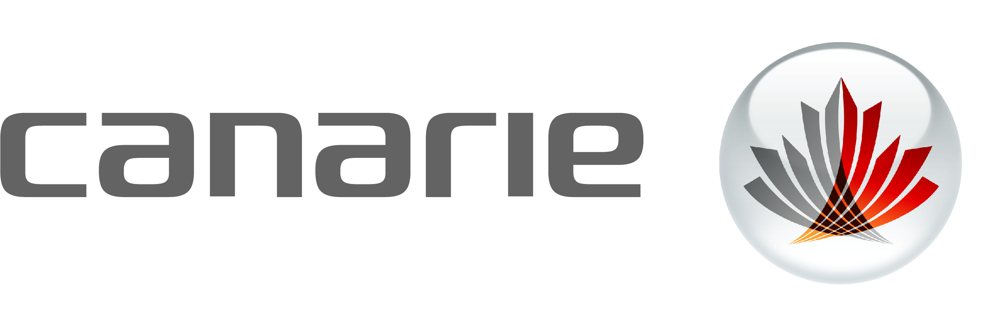
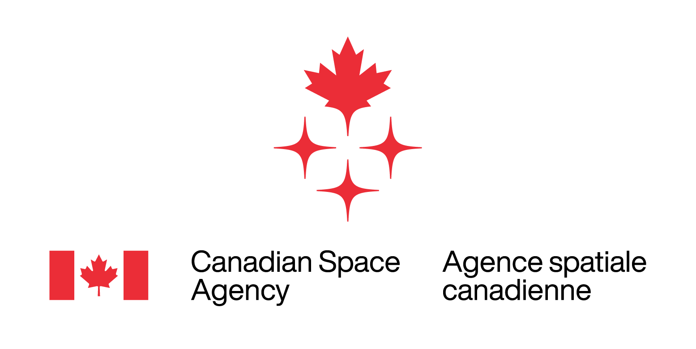

# Partners

---

The [National Research Council of Canada (NRC)](https://nrc.canada.ca/en) is Canada's federal research and development organization.

The NRC is home to the [Canadian Astronomy Data Centre](https://www.cadc-ccda.hia-iha.nrc-cnrc.gc.ca/en/) and the [Canadian Advanced Network for Astronomy Research (CANFAR)](https://www.canfar.net/).

---

- 

    ---

    [CANARIE](https://www.canarie.ca) operates Canada's national research and education network, connecting Canadian researchers and educators to each other and to international data, computing, and collaborators.

- 

    ---

    Digital Research Alliance Canada coordinates and funds advanced research computing, data management, and research software in partnership with regional organizations. Its compute and storage systems host CANFAR's primary deployment.

- 

    ---

    The [Canadian Space Agency](https://www.asc-csa.gc.ca/eng/) leads Canada's space astronomy program and funds the [Canadian Astronomy Data Centre](https://www.cadc-ccda.hia-iha.nrc-cnrc.gc.ca/en/), supporting CANFAR's operation and development.

